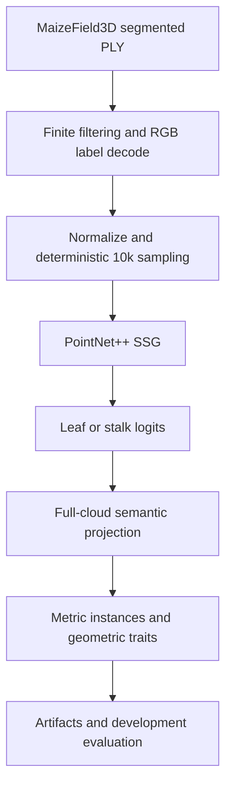

# Agri3D

[](https://github.com/GuilhermeFrAlmeida/agri3d-crop-phenotyping/actions/workflows/tests.yml) [](LICENSE)

**3D perception for maize structure segmentation and phenotyping research.**

Agri3D is an engineering and applied-research pipeline for semantic crop-structure segmentation from field-grown maize point clouds. It ingests the segmented 100k MaizeField3D subset, preprocesses plant-level PLY clouds, trains pure-PyTorch PointNet++ SSG, reports validation metrics on deterministic 10,000-point samples, and exposes a frozen inference-to-phenotype pipeline.

| At a glance | Current status |
|---|---|
| Best validation mIoU | **0.836603** — PointNet++ XYZ, Run 1 |
| Dataset subset | 520 annotated plants; 100k-point PLY source clouds |
| Frozen split | 364 train / 78 validation / 78 test; plant identity grouping |
| Neural input | 10,000 points per plant; XYZ in Runs 1–3, XYZ + estimated normals in Run 4 |
| Development | Runs 1–4 complete; Run 1 frozen. Phase 4A complete; 0.020 m / 32-neighbor graph frozen. Full Phase 4/5 validation pending |

Pipeline: **PLY → clean and decode RGB supervision → normalize and sample → PointNet++ SSG → leaf/stalk point labels → validation analysis**. Test data remains untouched.

## Overview

The repository focuses on binary per-point segmentation of **leaf** and **stalk** structures in individual maize plants. It includes deterministic preprocessing, controlled training/validation, per-plant error analysis, profiling and throughput tools. A CPU-compatible downstream pipeline now adds full-cloud projection, geometric leaf components and metric-space trait measurements. The [Phase 4A val5 graph sweep](docs/phase4a_instance_diagnostics.md) is complete; the 0.020 m / 32-neighbor instance configuration is frozen for full validation. Phase 4/5 is implemented with full validation pending; biological instance/trait accuracy remains unqualified.

## Key results

These are validation metrics on a fixed plant-identity split and fixed sampled points, not full-cloud test results. Run 1 remains the reference. The current comparisons use one seed and do not establish statistical significance.

| Experiment | Main change | Val mIoU | Leaf IoU | Stalk IoU | Status |
|---|---|---:|---:|---:|---|
| Geometric baseline | Geometry rules | 0.622986 | 0.817337 | 0.428635 | Reference baseline |
| Run 1 | PointNet++ XYZ | **0.836603** | **0.920242** | **0.752963** | Current champion |
| Run 2 | Geometry-preserving augmentation | 0.829574 | 0.919895 | 0.739252 | Rejected; below Run 1 |
| Run 3 | ReduceLROnPlateau on validation mIoU | 0.831723 | 0.918582 | 0.744863 | Rejected; below Run 1 |
| Run 4 | XYZ + estimated surface normals | 0.817336 | 0.908530 | 0.726141 | Rejected; below Run 1 |

See [results](docs/results.md) for selected epochs, per-class metrics, interpretation and evidence limits.

## Architecture

The current neural model has four PointNet++ SSG set-abstraction stages (10,000 → 1,024 → 256 → 64 → 16 centroids), feature propagation back to all input points and binary per-point logits. Runs 1–3 use XYZ only. Run 4 passes XYZ as geometry and estimated normals as separate point features; RGB is never a model feature.



See [architecture](docs/architecture.md) for training and model diagrams.

## Project status

- **Completed and measured:** frozen plant-level split, geometric baseline, PointNet++ XYZ Run 1, validation analysis, Run 2 augmentation comparison, Run 3 scheduler and Run 4 normals comparisons, Phase 3P profiling and throughput work.
- **Implemented, not yet qualified:** Phases 4/5 frozen semantic inference, nearest projection, geometric instances, metric traits, artifacts and validation evaluation. Real MaizeField3D execution is the next gate.
- **Deferred:** stronger neural architectures until downstream qualification; external robustness evaluation and biological trait-reference validation remain future work.

See the [roadmap](docs/roadmap.md) for the distinction between implemented and future work.

## Problem and dataset

Maize leaves and stalks form dense, branching 3D geometry. Agri3D currently addresses semantic segmentation as a foundation for later structural analysis. Experiments use the segmented 100k MaizeField3D subset: 520 annotated plants represented as 100,000-point XYZ+RGB PLY files. RGB encodes labels: black is stalk (class 1), non-black is leaf (class 0). It is supervision only and is excluded from model inputs.

The frozen manifest contains 364 training, 78 validation and 78 test plants, grouped by plant identity, not genotype. The global stalk-point fraction is approximately 22.63%. The external dataset is not bundled here; its dataset card specifies CC BY-NC 4.0. See [dataset details](docs/dataset.md) and [dataset licensing](docs/dataset_and_licensing.md).

## Pipeline

1. Read segmented PLY and retain aligned source indices and properties.
2. Filter non-finite XYZ and decode RGB labels.
3. Center and unit-sphere normalize the cleaned full cloud.
4. Deterministically sample 10,000 points for neural runs, preserving point/label/mask/index alignment.
5. Train or validate PointNet++ SSG with masked, unweighted cross-entropy and Adam.
6. Select regular-run best checkpoints by validation mIoU; analyze validation plants only.

Run 4 estimates kNN-PCA normals on cleaned full-resolution XYZ before normalization and sampling. See [Phase 3D](docs/phase3d_run4_normals.md) for the exact feature and cache contract.

## Experiments

The experiment sequence keeps negative comparisons visible. Run 2 tested augmentation and raised stalk precision while reducing recall and mIoU. Run 3 tested validation-mIoU plateau scheduling and did not surpass Run 1. Run 4 tested local surface orientation but also fell below Run 1. PointNet++ experimentation is frozen for downstream engineering. See the [experiment registry](docs/experiments.md).

## Performance engineering

Phase 3P profiled the pure-PyTorch model on a Tesla T4 and tested bounded loader/cache and batch-throughput settings. Reported peak allocated/reserved VRAM was about 325/359 MB. A bounded batch-size benchmark measured approximately 2.58, 3.58 and 4.28 samples/s for batch sizes 2, 4 and 8. Larger batches improve throughput but change optimizer grouping and BatchNorm statistics; official experiments retain batch size 2.

Qualified runtime controls: num_workers=2, pin_memory=true, non_blocking=true, prefetch_factor=2, persistent_workers=false. These are execution settings, not scientific changes. See [performance engineering](docs/performance.md) for evidence boundaries.

## Repository structure

```text
src/agri3d/     PLY I/O, preprocessing, geometry, models, training, analysis, performance
configs/        Scientific experiment configurations
scripts/        Training, validation, audit, analysis and benchmark CLIs
tests/          Synthetic unit, integration and reproducibility tests
docs/           Project guide, evidence, methods and phase records
```

## Quick start

```bash
git clone https://github.com/GuilhermeFrAlmeida/agri3d-crop-phenotyping.git
cd agri3d-crop-phenotyping
python -m venv .venv
source .venv/bin/activate
python -m pip install -e '.[dev,geometry,analysis]'
pytest -q
```

Tests use synthetic fixtures and do not download or open the dataset split. Dataset acquisition is separate; start with [dataset setup](docs/dataset.md).

## Reproducibility

Neural comparisons use the pinned plant-identity manifest, seed 42, 10,000 sampled points, batch size 2, PointNet++ SSG and validation-mIoU model selection. Do not regenerate the split. Checkpoints include experiment contracts and recovery state; Run 4 also checks feature/normal-policy provenance. See [reproducibility](docs/reproducibility.md) for acquisition, manifest, tiny-overfit gate, training, validation, analysis and resume instructions.

## Frozen semantic inference and phenotyping

```bash
python -m agri3d.pipeline analyze \
  --input "<PLANT_PLY>" --checkpoint "<RUN1_BEST_PT>" \
  --config configs/phenotyping_pipeline.yaml --device cpu \
  --output "<NEW_PLANT_OUTPUT>" --visualize
```

The pipeline preserves full metric geometry for height, PCA/graph leaf lengths, convex-hull/voxel canopy measurements and stalk descriptors. Outputs include semantic/instance arrays, scalar-labeled PLY, JSON, optional HTML, timings and checksummed provenance. Geometric components are not yet validated botanical leaf identities. PyTorch `.pt` is canonical; ONNX export is NOT QUALIFIED because modern capture fails at an existing tensor-boolean validation guard. See [Phases 4/5](docs/phases4_5_phenotyping_pipeline.md) and [interoperability](docs/model_interoperability.md).

## Documentation

- [Index](docs/README.md) · [Architecture](docs/architecture.md) · [Dataset](docs/dataset.md)
- [Experiments](docs/experiments.md) · [Results](docs/results.md) · [Performance](docs/performance.md)
- [Reproducibility](docs/reproducibility.md) · [Roadmap](docs/roadmap.md) · [Limitations](docs/limitations.md)
- [Dataset and licensing](docs/dataset_and_licensing.md) · [Public-release audit](docs/public_release_audit.md)

## Roadmap and limitations

Current status and planned directions are listed in the [roadmap](docs/roadmap.md). Results are validation-only, from one seed, on sampled points; test has not been evaluated. The split is not genotype-held-out, and there is no cross-dataset or biological-trait validation. Full-cloud projection and geometric instance/trait extraction are implemented with explicit limitations and await real-data qualification. See [limitations](docs/limitations.md).

## License

Repository code is licensed under [Apache 2.0](LICENSE). MaizeField3D is a separate external dataset under its own CC BY-NC 4.0 terms; it is not included or relicensed by this repository. See [dataset and licensing](docs/dataset_and_licensing.md).
