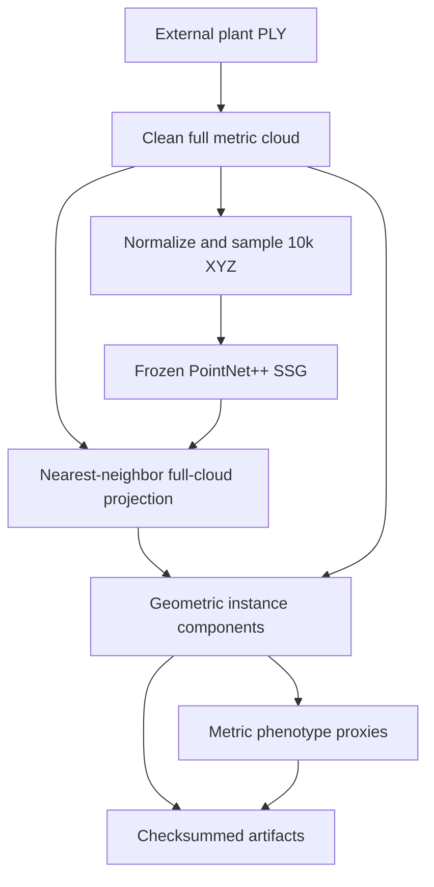

# Agri3D

[](https://github.com/GuilhermeFrAlmeida/agri3d-crop-phenotyping/actions/workflows/tests.yml) [](LICENSE)

**3D crop perception and structural phenotyping for field-grown maize point clouds.**

Agri3D combines deterministic point-cloud preprocessing, frozen PointNet++ leaf/stalk segmentation, full-cloud semantic projection, geometric instance components and metric phenotype proxies. It is an ongoing research-engineering project, with measured engineering qualification and explicit biological-accuracy limits.

**Current stage: QUALIFIED WITH LIMITATIONS.** The frozen pipeline completed **156/156 plant/mode executions on 78 validation plants, with zero failures**. The 78-plant test split remains untouched. No trained checkpoint or dataset is bundled.

## Technical Report

### [Agri3D — Current Stage Technical Report (PDF)](docs/reports/Agri3D_Current_Stage_Technical_Report.pdf)

The primary long-form project presentation covers controlled PointNet++ experiments, full-cloud projection, Phase 4 structural qualification, val78 evaluation, geometric phenotype extraction, runtime analysis, limitations and planned research stages. It documents the **current stage**, not a final project or biologically validated phenotype system.

## Key Results

| Evidence | Validation result |
|---|---|
| Frozen Run 1, XYZ / 10k points | mIoU **0.836603**, leaf IoU 0.920242, stalk IoU 0.752963; selected epoch 76 |
| Rejected controlled alternatives | Run 2 augmentation 0.829574; Run 3 scheduling 0.831723; Run 4 normals 0.817336 mIoU |
| Frozen val78 full-cloud projection | Sampled mIoU 0.83662 → projected mIoU **0.83967** |
| Structural components, oracle → predicted semantics | Mean **15.94 → 17.92**; reported mean paired gap +1.99 |

Projection preserved aggregate semantic quality in this evaluation; these figures do not establish improved model generalization. Component counts are **not verified biological leaf counts**. Training-run and later val78 sampled metrics are separate recorded results; see [results and evaluation scope](docs/results.md). Single-seed, validation-only evidence is not an independent test estimate.

## System Architecture



XYZ alone drives inference and geometric distances. MaizeField3D RGB encodes **supervision**, never model input. The downstream interface is model-neutral. See [architecture](docs/architecture.md).

## What the Pipeline Produces

- Per-point leaf/stalk labels on the cleaned full cloud.
- Deterministic geometric component IDs, unassigned-point accounting and attachment diagnostics.
- Full-cloud height, component count, PCA and graph-geodesic length proxies, convex-hull/voxel volumes and stalk descriptors.
- JSON reports, aligned label arrays, scalar PLY, timings, provenance and optional HTML views.

Biological instance identity, leaf count and phenotype accuracy remain unqualified. ONNX is also unqualified; PyTorch `.pt` is the canonical backend.

## Installation

Python **3.11 on Ubuntu 24.04** is the canonical CI environment. Package metadata allows Python ≥3.10; a wider version matrix is not currently qualified.

```bash
git clone https://github.com/GuilhermeFrAlmeida/agri3d-crop-phenotyping.git
cd agri3d-crop-phenotyping
python -m venv .venv
source .venv/bin/activate
python -m pip install --upgrade pip
python -m pip install -e .
```

On CPU-only systems, install the CPU PyTorch build first if needed: `python -m pip install torch --index-url https://download.pytorch.org/whl/cpu`. Keep an appropriate CUDA build on GPU systems.

For the geometry/test profile on Ubuntu, install Open3D's EGL runtime:

```bash
sudo apt-get update
sudo apt-get install -y --no-install-recommends libegl1
python -m pip install -e '.[dev,geometry,analysis]'
python -m ruff check .
python -m pytest -q
```

See [getting started](docs/getting_started.md) for core, geometry, visualization, development and interoperability profiles, dataset setup and notebook use.

## Quick Start and Common Workflows

No data is needed to run the synthetic tests or read the [report](docs/reports/README.md). With an external development PLY and a compatible Run 1 selected checkpoint:

```bash
python -m agri3d.pipeline analyze \
  --input <PLY_PATH> --sample-id <SAMPLE_ID> \
  --checkpoint <CHECKPOINT> --config configs/phenotyping_pipeline.yaml \
  --device cpu --output <OUTPUT_DIR>
```

Use a new output directory. Install `.[geometry,analysis,visualization]` and add `--visualize` for HTML views. Checkpoints are external artifacts: the repository does **not** provide a model-download URL. Standalone files do not reveal split membership; supply development files only.

Curated [notebooks](notebooks/README.md) cover PLY inspection, frozen semantic inference and full analysis. [Reproducibility](docs/reproducibility.md) covers scientific experiments and validation-only manifest workflows.

## Dataset Setup

The external **MaizeField3D segmented 100k** subset contains 520 annotated plants. The existing plant-identity split is **364 train / 78 validation / 78 test**, seed 42. Obtain data from the original distribution, pin its revision, preserve the existing manifest and keep data/checkpoints outside Git. RGB black means stalk and non-black means leaf only for these annotated exports.

See [dataset](docs/dataset.md) and [licensing/attribution](docs/dataset_and_licensing.md). Do not regenerate the frozen split to reproduce existing results. The test split remains reserved.

## Repository Structure

| Path | Purpose |
|---|---|
| `src/agri3d/` | Ingestion, preprocessing, models, training, inference, phenotyping and performance APIs |
| `configs/` | Scientific experiments, runtime presets and frozen geometric settings |
| `scripts/` | Training, validation, analysis and bounded profiling entry points |
| `notebooks/` | Thin public execution/inspection examples |
| `tests/` | Synthetic behavior, contracts, determinism and isolation checks |
| `docs/` | Current guides, report, historical experiment records and benchmark evidence |

## Documentation and Current Qualification

Start at the [documentation index](docs/README.md). Run 1 inference, full-cloud projection, val78 execution and artifact persistence are engineering-qualified on validation. Height is computationally qualified; instances are structurally qualified. Length/volume outputs are geometric proxies. The [qualification matrix](docs/results.md#qualification-matrix) distinguishes these from biological accuracy.

The instance graph is frozen at **0.020 m / 32 neighbors**, minimum component size 100 and attachment radius 0.03 m. Val78 was evaluation, not tuning. Failures or future revisions require a new explicit development experiment, not retrospective tuning on those same plants.

## Roadmap and Limitations

Planned work includes stronger 3D semantic architectures, controlled robustness evaluation, external-domain validation including a possible Pullally integration, and more stable deployment interfaces. These capabilities are **not implemented**. See [roadmap](docs/roadmap.md).

Current limits include one-seed neural comparisons, validation reuse, no genotype-held-out or cross-dataset qualification, no verified biological instance/trait references, and pure-PyTorch geometry that is not production-optimized. See [limitations](docs/limitations.md).

## Citation and License

Repository citation metadata is in [CITATION.cff](CITATION.cff); dataset citation and terms are [documented separately](docs/dataset_and_licensing.md).

**Source code: Apache-2.0**, under [LICENSE](LICENSE). **External MaizeField3D data: CC BY-NC 4.0**. The code license does not relicense the dataset. The report does not bundle the dataset; no separate report license is invented.
