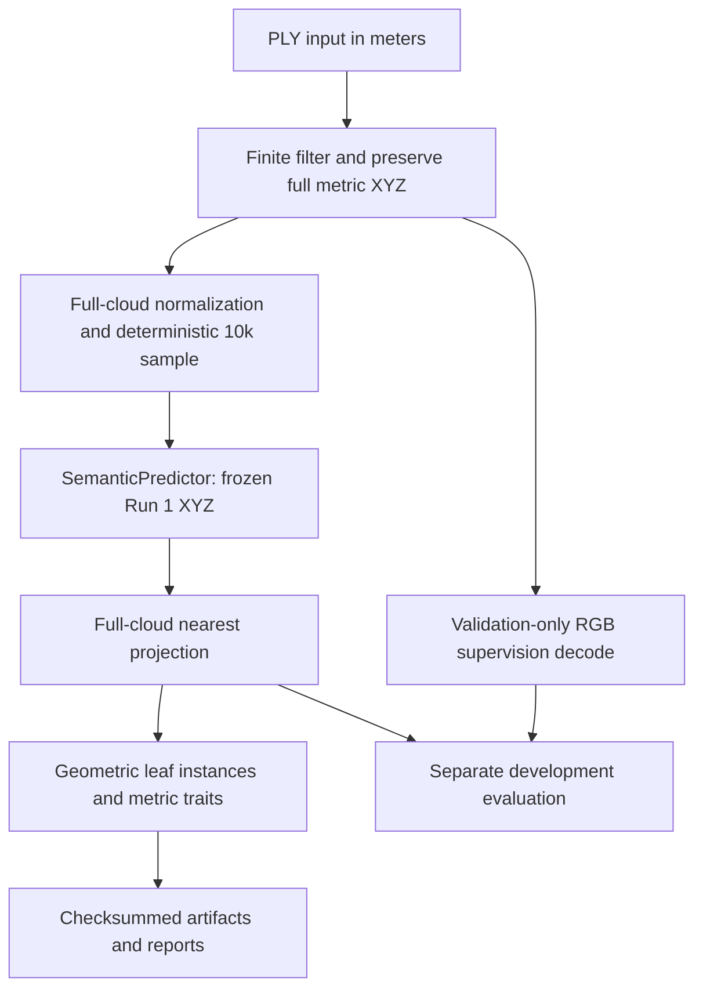
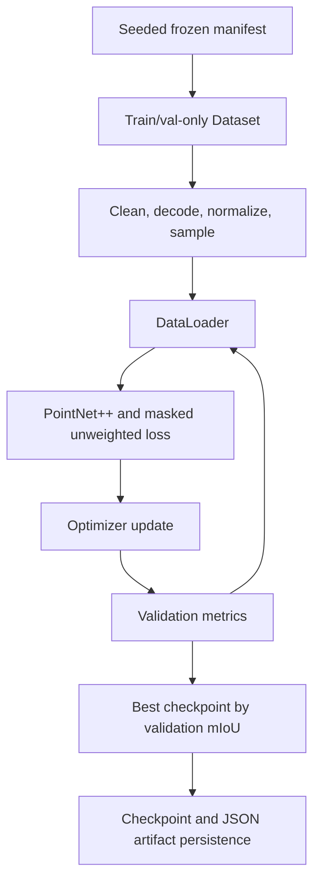
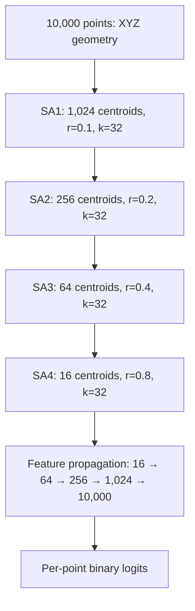
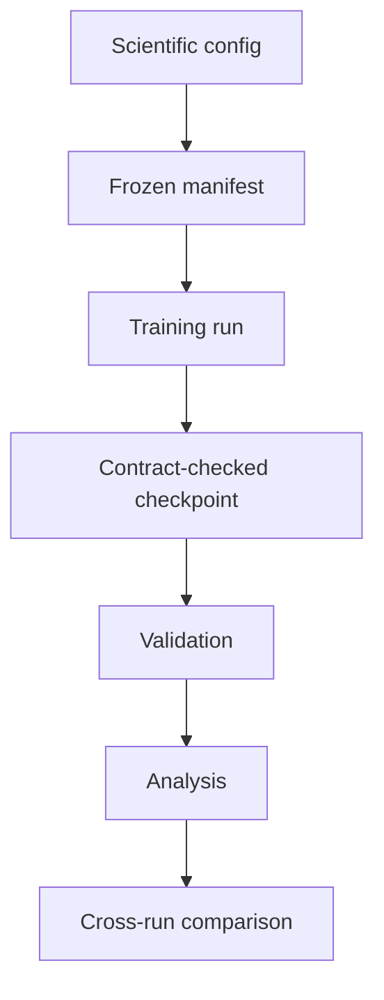
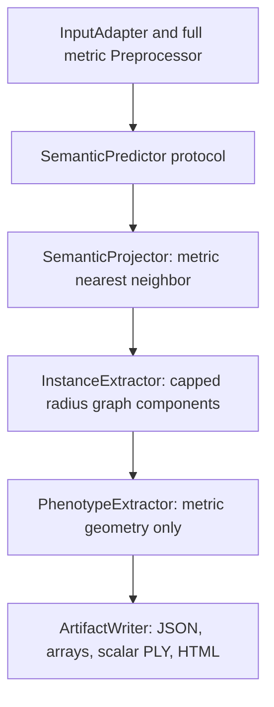

# Architecture

Agri3D implements semantic training plus a model-neutral inference, full-cloud projection, geometric structure and metric-measurement pipeline. The frozen downstream pipeline completed val78 engineering qualification with limitations (156 successful plant/mode executions, zero failures). Biological instance/trait accuracy remains unqualified. Run 1 is the semantic backend; stronger network comparisons remain planned.

## High-level system

RGB is never a model feature. The historical Run 4 normal-feature experiment remains implemented but was rejected and is not the frozen downstream backend. See [dataset](dataset.md), [Phase 3D](phase3d_run4_normals.md), and [Phases 4/5](phases4_5_phenotyping_pipeline.md).

## Training and checkpoint selection

The manifest records plant-level train/validation/test assignments, but training and validation entry points load only train and validation records. The test split is not evaluated. The optimizer is Adam; regular checkpoints preserve model/optimizer/RNG/loader/history state for recovery. Runs 1–4 use 100 epochs and batch size 2; Run 3 alone uses validation-mIoU ReduceLROnPlateau, while Run 4 uses estimated normals and no scheduler.

## PointNet++ SSG

Geometry operations (farthest-point sampling, radius neighborhoods and interpolation coordinates) always use XYZ. Runs 1–3 have no additional point features. Run 4 supplies estimated normals as a separate 3-channel feature tensor; they do not alter geometric distance calculations. All stages, centroid counts, radii, neighborhood sizes and MLP widths remain fixed. RGB is label supervision only.

## Experiment and reproducibility flow

Runtime options such as workers, pinning and cache location are recorded separately from scientific choices. See [reproducibility](reproducibility.md) and [experiments](experiments.md).

## Frozen downstream boundary

Only the backend adapter imports PointNet++ internals. The CLI composes it with downstream modules; the latter do not inspect the architecture. Clean metric coordinates and normalized 10k model coordinates remain separate. RGB is never a model feature. See [Phases 4/5](phases4_5_phenotyping_pipeline.md) and [interoperability](model_interoperability.md) for contract details. Val78 engineering execution is qualified with limitations; biological phenotype accuracy and ONNX remain unqualified.
