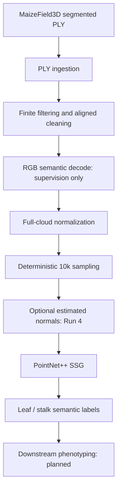
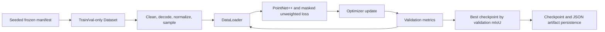
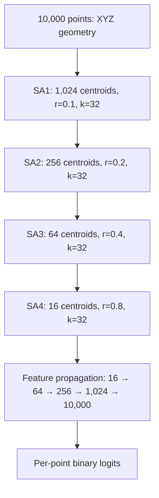

# Architecture

Agri3D currently implements the data-to-semantic-segmentation path. Instance reconstruction and phenotypic measurements are downstream directions, not a completed end-to-end feature.

## High-level system

For Run 4, normals are estimated on cleaned full-resolution XYZ before normalization/sampling. RGB is never passed as model input. See [dataset](dataset.md) and [Phase 3D](phase3d_run4_normals.md).

## Training and checkpoint selection

The manifest records plant-level train/validation/test assignments, but training and validation entry points load only train and validation records. The test split is not evaluated. The optimizer is Adam; regular checkpoints preserve model/optimizer/RNG/loader/history state for recovery. Runs 1–4 use 100 epochs and batch size 2; Run 3 alone uses validation-mIoU ReduceLROnPlateau, while Run 4 uses estimated normals and no scheduler.

## PointNet++ SSG

Geometry operations (farthest-point sampling, radius neighborhoods and interpolation coordinates) always use XYZ. Runs 1–3 have no additional point features. Run 4 supplies estimated normals as a separate 3-channel feature tensor; they do not alter geometric distance calculations. All stages, centroid counts, radii, neighborhood sizes and MLP widths remain fixed. RGB is label supervision only.

## Experiment and reproducibility flow

Runtime options such as workers, pinning and cache location are recorded separately from scientific choices. See [reproducibility](reproducibility.md) and [experiments](experiments.md).
