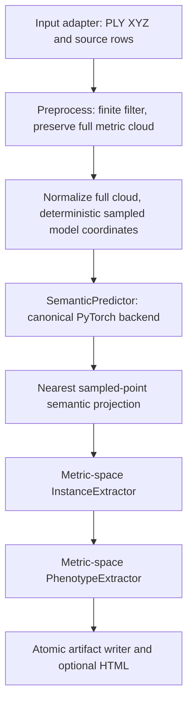

# Phases 4/5 — frozen inference, structure and phenotype measurements

**Status: IMPLEMENTED — FULL VALIDATION PENDING.** Phase 4A is complete. The bounded five-plant diagnostic selected **0.020 m / 32 neighbors**, now frozen in the production configuration before val78. See the [measured Phase 4A report](phase4a_instance_diagnostics.md). This qualifies a configuration for evaluation, not biological instance or phenotype accuracy. Run 1 remains the frozen semantic reference; test remains untouched.

**The 78-plant validation execution is an evaluation run, not a tuning run.** Report failures without retrospective parameter tuning against the same 78 plants. Any algorithmic revision must be a new experiment with an explicit development protocol. Advanced model work remains deferred.

## Scientific state

Run 4 estimated normals completed with validation accuracy 0.9263846, mIoU 0.8173358, leaf IoU 0.9085305, stalk IoU 0.7261411, stalk precision 0.8194030 and recall 0.8644969. It is rejected. Run 1 remains champion at validation mIoU 0.8366027 (10k sampled-point evaluation). Its value is not replaced by projected-cloud metrics. New architecture work is deferred until this downstream system has been evaluated.

## Architecture and coordinate contracts



`SemanticPredictor.predict(xyz, features=None)` returns typed labels, logits, probabilities, input-local source indices, model metadata and optional backend timings. Only the PointNet++ backend imports the model/runner; downstream algorithms do not branch on model architecture. The CLI is the composition root. Future models can replace that backend and their model-specific preprocessing contract.

The `.pt` loader uses the existing restricted checkpoint reader, validates the saved contract/hash and strict model weights, requires regular-run XYZ input, and enforces the Run 1 scientific contract by default. Known nonselected current weights are rejected; supply `best.pt`. Legacy missing metadata is retained as null rather than invented. The payload's `best_miou` is never attributed to later `last.pt` weights. A missing experiment name remains null; the compatible Run 1 policy classification is explicitly repository-derived rather than fabricated checkpoint metadata. Checkpoint-derived data, repository policy and supplied metadata are separate. No checkpoint is bundled.

Metric input must be in **meters with vertical Z**, as established by the MaizeField3D development contract. There is no CRS/unit detection. Finite filtering retains original PLY row IDs. The full clean cloud is centered and scaled using the existing normalizer, then the unchanged voxel sampler uses SHA256-derived `42:0:sample_id` RNG, 10k points and normalized voxel size 0.005. This reproduces epoch-0 validation sampling for the **same sample ID**. For standalone files, the default ID is the filename stem; use `--sample-id` to reproduce the manifest ID. RGB is not read by the semantic backend.

The geometry passed to instance/trait extraction is the original cleaned metric cloud, never unit-sphere coordinates. `source_index` in saved PLY addresses original input rows; internal instance indices address cleaned rows. Padded sample repeats are masked and omitted from projection reference points.

## Projection — one frozen default

`nearest_neighbor` builds a SciPy cKDTree over sampled **metric** XYZ. Each full cleaned point receives the nearest sampled point's label/probability. Exact-distance ties choose the lowest sampled slot. Original sampled row predictions are explicitly restored by source identity, so coincident points cannot erase distinct predictions. No voting or learned projection is added. Uniform translation/positive isotropic scale preserves nearest-neighbor geometry mathematically; finite-precision boundary ties can differ across representations/platforms.

The evaluator reports sampled neural metrics separately from projected full-cloud metrics using independent global confusion matrices. Point counts, accuracy, mIoU and each class's IoU, precision, recall and F1 are retained. Oracle-semantic mode does not invoke the model; it isolates geometric extraction.

## Phase 4 — geometric_graph_v1

Frozen production parameters selected by [Phase 4A](phase4a_instance_diagnostics.md), before val78. The historical initial setting was 0.015 m / 16 neighbors; it is retained only in the explicit historical replay config. Minimum size and attachment radius are unchanged:

| Parameter | Default | Meaning |
|---|---:|---|
| neighborhood_radius_m | 0.020 | Maximum edge length in meters |
| max_neighbors | 32 | Up to 32 nearest other leaf points per query; graph is symmetrized |
| min_leaf_points | 100 | Minimum accepted component size |
| attachment_radius_m | 0.03 | Closest leaf/stalk-pair distance for a diagnostic attachment flag |

The exact single-worker cKDTree query is capped, distances/row IDs order each returned candidate set, and a symmetric sparse graph has at most 2Nk directed entries. Connected components become candidates. Small components become unassigned/noise. Accepted IDs are consecutive in smallest-cleaned-source-row order. Stalk points have instance ID 0, accepted leaves positive IDs, rejected leaf points -1. Every point belongs to exactly one category. Component sizes, rejected counts, unassigned fraction, stalk PCA axis, nearest attachment point/distance and attachment consistency are reported.

This intentionally conservative baseline has **no implicit split/merge pass**. Touching leaves may merge, disconnected portions may split, and degree/radius caps may fragment sparse leaves. Attachment checks do not correct IDs or prove botanical validity. Equal-distance kNN cutoff membership follows the installed SciPy implementation; deterministic repeated execution is tested, cross-version bitwise identity is not promised. No N×N matrix is built.

## Instance and phenotype reference evidence

The [official dataset card](https://huggingface.co/datasets/BGLab/MaizeField3D) and [paper](https://doi.org/10.1016/j.plaphe.2025.100108) describe individually colored leaves and leaf-order conventions. The paper explicitly describes instance RGB and points to Supplementary Table S1 (up to 16 leaf identities). The [supplement link](https://pmc.ncbi.nlm.nih.gov/articles/instance/13109309/bin/mmc1.pdf) returned a download-preparation/inaccessible page in this environment, so its numeric table was not inspected. No local PLY palette/instance IDs were available to verify a lossless mapping of rare/darkened RGB. **Default instance GT remains unverified.** Color diversity alone is never decoded as instances. Existing black=stalk/non-black=leaf semantic decoding is unchanged.

An explicit reviewed palette can be supplied with `--instance-palette`:

```json
{"schema_version": 1, "evidence": "<source revision and independently reviewed palette evidence>",
 "rgb_to_instance": {"0,0,0": 0, "<R,G,B>": 1}}
```

The example is a schema, not a real dataset palette. Unknown colors fail; black must be stalk 0, all other colors map to positive leaf IDs. Multiple verified color variants may map to one leaf. This input is an external scientific assertion requiring independent review, not automatic verification by the software. With it, the evaluator computes Hungarian point-IoU matching (threshold 0.5), matched IoU/precision/recall, leaf-count errors and over/under-segmentation overlap counts. Over/under counts use any nonzero point overlap, exclude stalk/noise and can be noise-sensitive. Without it, outputs are **diagnostics, not accuracy**.

Upstream descriptions mention leaf counts, but available repository metadata adapters expose quality flags rather than verified quantitative trait references. No plant-height, leaf-length, count value or biological accuracy is invented. Optional `--reference-traits` CSV requires exact `sample_id,height_m,leaf_count` columns (blank optional values), unique IDs, meters, integral nonnegative counts and explicit `--reference-evidence`. When supplied, matched height/count error, MAE, RMSE, bias and exact-match fraction are reported separately by semantic source. Unmatched samples have no reference metric. No automatic inference from filenames or boolean quality flags is used.

## Phase 5 measurements

- **Height:** full cleaned-cloud max Z minus min Z, plus Z bounds and point count. Independent of neural sampling and semantic labels.
- **Leaf count:** number of accepted geometric components; raw/rejected counts and unassigned fraction remain auditable.
- **PCA leaf length:** first-axis projection extent. Inexpensive; can underestimate curved leaves and is not a biological reference.
- **Graph leaf length:** voxel representatives (0.01 m), up to 8 neighbors within 0.03 m, at most 2,048 nodes; two Dijkstra sweeps estimate a graph-diameter lower bound. This is not an exact longest path or midrib skeleton. Disconnected/over-budget/degenerate graphs yield null with a reason; PCA remains available.
- **Canopy convex hull:** volume enclosed by all predicted leaf points, including unassigned ones. Degenerate hulls return null; no jitter is added.
- **Voxel occupancy:** occupied leaf-point cells × (0.01 m)³, with grid anchored at metric origin (0,0,0). It depends on grid size/origin and measures sampled surface occupancy, not solid tissue volume. It is not necessarily below the convex hull volume.
- **Stalk:** count, metric centroid, vertical extent and canonical-sign PCA axis. No diameter accuracy claim.

## Artifacts and schema

Each output directory is new-only and atomically renamed after completion. Source PLY/checkpoint files are never modified. Files:

| File | Contents |
|---|---|
| phenotype.json | schema_version=1; plant/source counts; semantic source/model/metrics; structure diagnostics; phenotypes, per-leaf measurements, stalk descriptors, methods, timing/provenance |
| semantic_labels.npy | cleaned-full-cloud semantic labels (0 leaf / 1 stalk) |
| instance_labels.npy | cleaned-full-cloud instance IDs (-1 noise / 0 stalk / positive leaf) |
| structure.ply | one metric XYZ copy with scalar semantic_label, instance_id and original source_index; annotation RGB is not overwritten or duplicated |
| sample_predictions.npz | normalized 10k points, logits/probabilities/labels, original source rows and valid mask (predicted mode only) |
| provenance.json / timing.json | hashes, config, code/library/backend identity and stage timing |
| artifacts.json | relative filename → byte size and SHA256 inventory (excluding its own hash) |
| views.html | optional deterministic bounded input/semantic/instance and GT error panels |

Batch output contains per-plant directories, `per_plant.csv`, `phenotypes.csv`, `timings.csv`, `failures.json`, `summary.json`, `configuration.json`, `provenance.json`. CSV rows link to artifact directories. Default is **continue on error**, with nonzero CLI exit if any plant failed; `--fail-fast` persists partial summaries then raises. A new output path is required for every run.

Provenance includes checkpoint bytes/hash/contract, input bytes/hash, sample identity, manifest exact-byte hash, complete config, normalization, backend/device, package versions and code SHA where available. When `.git` is unavailable, use `--code-commit` with the full reviewed SHA; it is labeled supplied, not auto-detected. Missing provenance stays null.

## Commands: local or Colab

Install the appropriate CPU/CUDA PyTorch build first; in Colab keep its CUDA build. From the reviewed checkout:

```bash
python -m pip install -e '.[dev,geometry,analysis,interoperability]'
python -m pytest -q
CHECKPOINT="<RUN1_BEST_PT>"
MANIFEST="<FROZEN_MANIFEST>"
DATA_ROOT="<SEGMENTED_PLY_ROOT>"
OUT="<NEW_ARTIFACT_ROOT>"
CONFIG=configs/phenotyping_pipeline.yaml
```

Single supplied plant (CPU default):

```bash
python -m agri3d.pipeline analyze \
  --input "<PLANT_PLY>" --sample-id "<MANIFEST_SAMPLE_ID>" \
  --checkpoint "$CHECKPOINT" --config "$CONFIG" --device cpu \
  --visualize --output "$OUT/single"
```

The standalone file API cannot infer train/val/test membership from an arbitrary filename. Supply development files only. Manifest-driven CLIs below restrict themselves to validation, validate split structure and the model's manifest hash, and never check/open test PLYs.

Bounded validation experiments A–D (both oracle and projected semantics):

```bash
python scripts/evaluate_phenotyping_pipeline.py \
  --manifest "$MANIFEST" --root "$DATA_ROOT" --checkpoint "$CHECKPOINT" \
  --config "$CONFIG" --split val --max-plants 5 --mode both \
  --device cpu --visualize --output-dir "$OUT/val5"
```

Full validation only (78 plants; no `--max-plants`):

```bash
python scripts/evaluate_phenotyping_pipeline.py \
  --manifest "$MANIFEST" --root "$DATA_ROOT" --checkpoint "$CHECKPOINT" \
  --config "$CONFIG" --split val --mode both \
  --device cuda --output-dir "$OUT/val78"
```

Use `--device cpu` for fully CPU execution. GPU only accelerates semantic inference; projection, instances, measurements and serialization stay CPU. No GPU training is performed. For oracle-only geometry omit the checkpoint and use `--mode oracle`. A predicted-only batch is also available through `python -m agri3d.pipeline analyze-batch --manifest ... --root ... --checkpoint ... --split val --output-dir ...`.

ONNX attempt and requalification commands/status are in [model interoperability](model_interoperability.md). Export failure exit code 2 is an explicit NOT QUALIFIED outcome, not permission to switch backends.

## Experiments, timing and implementation verification

The evaluation harness separates A: sampled vs projected semantic scores; B: oracle vs predicted structure diagnostics/optional verified instance scores; C: convex-hull minus voxel-volume distributions; D: per-plant mean graph-length minus PCA-length distributions. It also produces per-stage mean/median/P95/max. Undefined methods/references remain null. The Phase 4A-selected fixed radii are frozen; the full validation execution does not tune them.

Wall timing covers load, filtering, optional GT decoding, normalization, sampling, inference, projection, instances, measurements and payload serialization. The total includes hash/provenance work but excludes final JSON bookkeeping. GPU inference wall time includes transfers and synchronization. When CUDA is used, a separately labeled nested event duration measures forward+softmax only and must not be added to wall-stage totals.

Full test suite: **188 passed, 4 skipped** (two worker-socket checks and two CUDA-only checks unavailable in this CPU environment). Changed-module E9/F/I lint and compilation pass. Synthetic verification includes fixed-10k single-plant CPU CLI, repeated sampling/prediction, finite-filter/source alignment, source-label preservation, instance accounting, synthetic traits, failure logs, checksummed outputs and validation/test isolation. One generated 100k-point stalk/two-ribbon cloud with random model weights completed oracle and predicted pipelines, including HTML/PLY/arrays (about 3.37 s and 1.30 s on this CPU runtime). Oracle semantics yielded two accepted geometric leaf components; the random model yielded none. These are single execution smokes, **not plant accuracy, reference model runtime, production latency or a speedup**. Real MaizeField3D structural/phenotype metrics remain unavailable.

Recommended next experiment: verify annotation/reference semantics on a reviewed development subset, then execute the five-plant oracle/predicted workflow. Inspect projected semantic errors and component/attachment diagnostics before expanding to all 78 validation plants or considering geometry-threshold changes. Test stays unopened. Advanced neural architectures are deferred.
